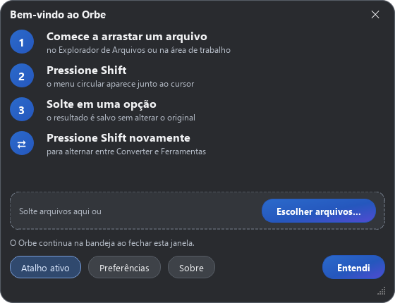

# Orbe — Edição Estúdio

Conversão de arquivos e edição de imagens em um menu circular, com interface em
português, cinza escuro e fundos opacos. Identidade e personalização por
**Nexo Atelier**, pseudônimo escolhido para o projeto.
Informações do produto em [CREDITS.md](CREDITS.md) e avisos de licença em [LICENSE](LICENSE).

[Repositório e versões do Orbe](https://github.com/IanEichler/Orbe).




## Usar

1. Abra o Orbe. Na primeira abertura, aparece apenas a confirmação de instalação
   com instruções curtas. Feche com **Entendi**; o aplicativo fica na bandeja.
   Para escolher arquivos pela central, use **Abrir Orbe** no menu da bandeja.
2. Escolha a conversão ou ferramenta no menu circular.
3. Fora da central, comece a arrastar um arquivo e pressione **Shift**.
4. Pressione **Shift** novamente para alternar entre **Converter** e **Ferramentas**.
5. Solte o arquivo em uma opção. Os resultados são salvos ao lado do original,
   ou na subpasta **Orbe**, conforme a preferência. O original é preservado.

A confirmação aparece uma vez; as próximas inicializações ficam na bandeja.
A central e as instruções completas ficam disponíveis em **Abrir Orbe** e
**Como usar** no menu da bandeja.
As notificações permitem abrir o resultado, ver a pasta e desfazer.
Fechar a janela mantém o aplicativo na bandeja. Use **Sair do Orbe** no menu da
bandeja para encerrar. O botão **Atalho ativo** pausa ou reativa o atalho global.

## Recursos

- Imagens: PNG, JPG, WEBP, HEIC, TIFF, AVIF, BMP, ICO, GIF e PDF.
- Várias imagens para um único PDF.
- Imagens: comprimir, redimensionar, recortar, ajustar, anotar, ocultar áreas,
  adicionar fundo e consultar/remover metadados.
- PDF: converter para JPG, PNG, DOCX e TXT; comprimir, separar, girar, unir,
  proteger com senha, extrair imagens e consultar/remover metadados.
- Word e texto: conversões para PDF e outros formatos compatíveis.
- Notificações com abrir, mostrar na pasta e desfazer.
- Configuração da tecla, pasta de saída, qualidade, resolução e início com o sistema.

## Executar a partir do código

```powershell
py -3.12 -m venv .venv
.\.venv\Scripts\python.exe -m pip install -r requirements.txt
.\.venv\Scripts\pythonw.exe -m orbe
```

O pacote da aplicação é `orbe`. Para executar com console,
use `python.exe` no lugar de `pythonw.exe`. Em macOS/Linux: `python -m orbe`.
O atalho global depende de X11 no Linux; sessões Wayland podem restringir sua
ativação. Os logs ficam em `%LOCALAPPDATA%\Orbe\log.txt` no Windows.

## Desenvolvimento

```powershell
.\.venv\Scripts\python.exe -m pip install pytest
$env:QT_QPA_PLATFORM = 'offscreen'
.\.venv\Scripts\python.exe -m pytest -q
.\.venv\Scripts\python.exe -m orbe --selftest
```

Veja [a arquitetura](docs/ARCHITECTURE.md). A aplicação agora separa inicialização,
controle, seleção, catálogo, tarefas, comunicação local e apresentação. Os editores
foram divididos por responsabilidade e os arquivos originais do usuário são
preservados nas operações de conversão e edição.

O arquivo `Orbe.spec` prepara uma compilação Windows em pasta com PyInstaller
(`pyinstaller Orbe.spec --noconfirm`, após instalar PyInstaller). O instalador
`installer/Orbe.iss` usa essa pasta e pode ser compilado com Inno Setup
(`ISCC installer/Orbe.iss`). Ao terminar a instalação, ele inicia o aplicativo
com `--installed`, exibindo somente a confirmação compacta, inclusive se o Orbe
já estiver ativo. `--quiet` inicia em segundo plano sem abrir janelas.
O fluxo **Compilar e publicar Orbe** executa os testes, compila os pacotes para
Windows, macOS e Linux e publica os arquivos nas versões do GitHub. Os fluxos de
gravação e testes em uma área de trabalho real são acionados manualmente.

## Visual e identidade

A logo do Orbe usa duas setas circulares em azul e branco sobre um fundo cinza
escuro. Os ícones do aplicativo, da bandeja e das configurações de empacotamento
usam essa identidade. O menu radial, os controles arredondados e as janelas
compactas têm fundos sólidos, sem translucidez, refração, desfoque ou captura da
área de trabalho. A tela **Sobre o Orbe** apresenta o produto e permite consultar
o arquivo de licença que acompanha a distribuição.

## Idioma

A interface, as mensagens, os resumos das operações e os sufixos dos arquivos
gerados usam português do Brasil. Os diálogos do Qt carregam a tradução oficial
pt-BR. Nomes próprios, formatos, identificadores técnicos e os avisos originais
da licença são preservados. Os arquivos e textos fornecidos pelo usuário não são
traduzidos nem modificados pela localização da interface.
