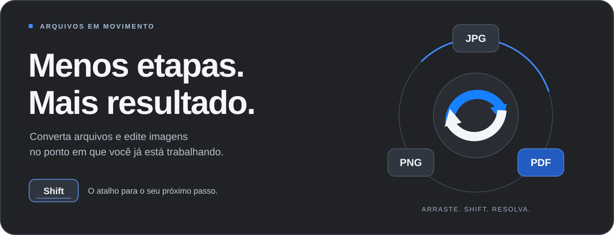
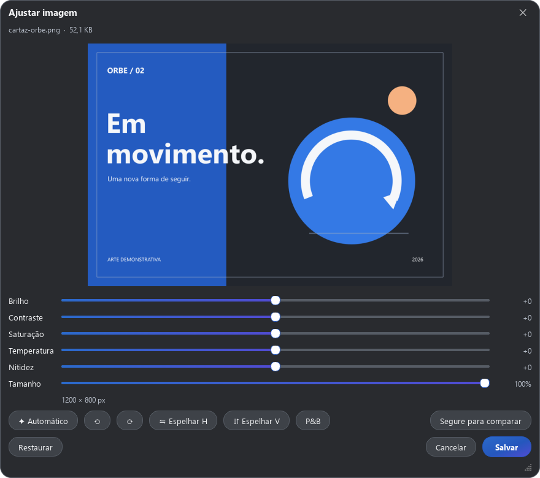

<div align="center">


# Orbe

**Arraste. Shift. Resolva.**

Conversão de arquivos, edição de imagens e ferramentas de PDF.<br>
Tudo em um menu circular, junto ao cursor.

<p>
  <a href="https://github.com/IanEichler/Orbe/releases/tag/latest"></a>
  
  
  <a href="LICENSE"></a>
</p>

<p>
  <a href="https://github.com/IanEichler/Orbe/releases/latest/download/Orbe-Setup.exe"></a>
  <a href="https://github.com/IanEichler/Orbe/releases/tag/latest"></a>
</p>

[Em ação](#em-ação) · [Recursos](#recursos) · [Baixar](#baixar) · [Como usar](#como-usar) · [Desenvolvimento](#desenvolvimento)

</div>



## Seu fluxo, com um atalho

Começou a arrastar um arquivo? Pressione **Shift**. O Orbe abre as opções de
conversão e edição no cursor. Escolha uma delas e solte o arquivo para continuar.

Um JPG vira PDF. Uma imagem ganha novas dimensões. Vários PDFs viram um só.
As ferramentas aparecem de acordo com o que você selecionou.

| No cursor | No seu computador | Com o original preservado |
| :--- | :--- | :--- |
| Menu circular com as ações compatíveis com a seleção. | Conversão e edição executadas localmente. | As operações criam arquivos de saída e evitam sobrescrever os originais. |

## Em ação

<table>
  <tr>
    <td align="center" width="38%">
      
      <br><strong>As ferramentas vêm até o cursor.</strong>
      <br>Pressione Shift para alternar entre os menus.
    </td>
    <td align="center" width="62%">
      
      <br><strong>Edite com uma prévia do resultado.</strong>
      <br>Ajustes, comparação com o original e salvamento de uma cópia.
    </td>
  </tr>
</table>

<sub>Capturas da interface real do Orbe. A arte exibida no editor é um arquivo demonstrativo.</sub>

## Recursos

### Converta e continue

- Troque o formato de imagens, PDFs, documentos Word e arquivos de texto.
- Transforme várias imagens em **um único PDF**.
- Processe vários arquivos compatíveis na mesma seleção.
- Receba uma notificação com acesso ao resultado, à pasta e à ação de desfazer.

### Dê o acabamento nas imagens

| Ferramenta | O que você pode fazer |
| :--- | :--- |
| **Comprimir** | Ajustar a qualidade ou buscar um tamanho de arquivo desejado. |
| **Dimensões** | Redimensionar por porcentagem, largura, altura ou limite de tamanho. |
| **Recortar** | Escolher o enquadramento e usar proporções predefinidas. |
| **Ajustar** | Alterar brilho, contraste, saturação, temperatura, nitidez e tamanho. |
| **Anotar** | Adicionar textos, formas e setas. |
| **Ocultar** | Aplicar tarjas, pixelização ou desfoque em trechos da imagem. |
| **Fundo** | Criar composições com cores, gradientes, margens e cantos arredondados. |
| **Metadados** | Consultar e remover informações incorporadas ao arquivo. |

### Coloque os PDFs em ordem

**Comprimir · Separar · Girar · Unir · Proteger com senha · Extrair imagens · Consultar e remover metadados**

A opção **Unir** aparece quando você seleciona mais de um PDF.

## Formatos

| Entrada | Conversões disponíveis |
| :--- | :--- |
| **Imagens** | PNG, JPG, WEBP, HEIC, TIFF, AVIF, BMP, PDF, ICO e GIF. |
| **PDF** | JPG, PNG, DOCX e TXT. |
| **Word — DOCX** | PDF e TXT. |
| **Texto** | PDF e DOCX. |

O Orbe abre imagens em JPG/JPEG, PNG, WEBP, HEIC/HEIF, TIFF, AVIF, BMP, ICO e GIF.
As opções do menu se ajustam ao formato de origem. Imagens animadas ou com várias
páginas são processadas a partir do primeiro quadro.

## Baixar

| Sistema | Download | Escolha esta opção quando… |
| :--- | :--- | :--- |
| **Windows — instalador** | [**Orbe-Setup.exe**](https://github.com/IanEichler/Orbe/releases/latest/download/Orbe-Setup.exe) | Quiser instalar para seu usuário, com atalhos e integração ao sistema. |
| **Windows — portátil** | [Orbe.exe](https://github.com/IanEichler/Orbe/releases/latest/download/Orbe.exe) | Preferir executar diretamente, sem instalar. |
| **macOS — Apple Silicon** | [Orbe-mac-apple-silicon.dmg](https://github.com/IanEichler/Orbe/releases/latest/download/Orbe-mac-apple-silicon.dmg) | Seu Mac tiver um chip da família Apple Silicon. |
| **macOS — Intel** | [Orbe-mac-intel.dmg](https://github.com/IanEichler/Orbe/releases/latest/download/Orbe-mac-intel.dmg) | Seu Mac usar um processador Intel. |
| **Linux — AMD64** | [Orbe-linux-amd64.deb](https://github.com/IanEichler/Orbe/releases/latest/download/Orbe-linux-amd64.deb) | Usar Debian 12 ou uma distribuição compatível com o pacote. |

[Ver todos os arquivos e as notas da versão →](https://github.com/IanEichler/Orbe/releases/tag/latest)

## Instalação

<details open>
<summary><strong>Windows</strong></summary>

1. Baixe e execute o **Orbe-Setup.exe**.
2. Escolha se deseja iniciar com o Windows, adicionar o menu de contexto e criar um atalho.
3. Ao concluir, aparece apenas uma confirmação compacta com as instruções essenciais.
4. Clique em **Entendi**. O Orbe continua ativo na bandeja, perto do relógio.

A instalação é feita para o seu usuário. A versão portátil pode ser executada
diretamente pelo arquivo **Orbe.exe**.

</details>

<details>
<summary><strong>macOS</strong></summary>

Abra o DMG da arquitetura do seu Mac e arraste o **Orbe** para **Aplicativos**.
O aplicativo fica na barra de menus.

Também é possível usar o instalador pelo terminal:

```bash
curl -fsSL https://raw.githubusercontent.com/IanEichler/Orbe/main/install-mac.sh | ORBE_REPOSITORY=IanEichler/Orbe bash
```

</details>

<details>
<summary><strong>Linux</strong></summary>

Depois de baixar o pacote, execute na pasta do download:

```bash
sudo apt install ./Orbe-linux-amd64.deb
```

Abra o **Orbe** pelo menu de aplicativos. O atalho global de arrastar + Shift
requer uma sessão **X11**. Em sessões Wayland, use **Escolher arquivos…** no
menu do ícone do aplicativo.

</details>

## Como usar

| 1. Arraste | 2. Pressione Shift | 3. Solte |
| :--- | :--- | :--- |
| Comece a arrastar um arquivo no gerenciador de arquivos ou na área de trabalho. | O menu aparece no cursor. Pressione novamente para alternar entre **Converter** e **Ferramentas**. | Solte sobre a ação desejada. Se houver ajustes, revise a prévia e salve. |

Você também pode clicar no ícone do Orbe na bandeja, abrir a central e usar
**Escolher arquivos…** ou soltar arquivos na área indicada.

### O resultado fica fácil de encontrar

Os arquivos são salvos **ao lado do original** por padrão. Em Preferências, você
pode escolher uma subpasta **Orbe**. As notificações permitem:

- **Abrir** o arquivo gerado.
- **Ver na pasta** para localizar o resultado.
- **Desfazer** a operação, removendo os arquivos de saída.

## Do seu jeito

Em **Preferências**, ajuste:

| Opção | Configuração |
| :--- | :--- |
| **Tecla do menu** | Shift, Ctrl ou Alt. No macOS, Control ou Option. |
| **Onde salvar** | Ao lado do original ou em uma subpasta Orbe. |
| **Qualidade** | Qualidade de saída para JPG e WebP. |
| **PDF → imagem** | 150, 200 ou 300 dpi. |
| **Início automático** | Iniciar o Orbe com o sistema. |

O botão **Atalho ativo** permite pausar e reativar o atalho global.

## Desenvolvimento

O projeto usa **Python 3.12**, **PySide6/Qt**, **Pillow**, **PyMuPDF**, **NumPy**
e **python-docx**, com integrações próprias para cada sistema.

<details>
<summary><strong>Executar a partir do código</strong></summary>

```bash
git clone https://github.com/IanEichler/Orbe.git
cd Orbe
```

**Windows**

```powershell
py -3.12 -m venv .venv
.\.venv\Scripts\python.exe -m pip install --prefer-binary -r requirements.txt
.\.venv\Scripts\pythonw.exe -m orbe
```

**macOS e Linux**

```bash
python3.12 -m venv .venv
source .venv/bin/activate
python -m pip install --prefer-binary -r requirements.txt
python -m orbe
```

Use `--quiet` para iniciar em segundo plano. O argumento `--installed` abre a
confirmação compacta de instalação.

</details>

<details>
<summary><strong>Rodar os testes</strong></summary>

No Windows:

```powershell
.\.venv\Scripts\python.exe -m pip install pytest
$env:QT_QPA_PLATFORM = "offscreen"
.\.venv\Scripts\python.exe -m pytest -q
.\.venv\Scripts\python.exe -m orbe --selftest
```

No macOS e Linux, com o ambiente virtual ativo:

```bash
python -m pip install pytest
QT_QPA_PLATFORM=offscreen python -m pytest -q
QT_QPA_PLATFORM=offscreen python -m orbe --selftest
```

</details>

<details>
<summary><strong>Compilar e distribuir</strong></summary>

```bash
python -m pip install pyinstaller
pyinstaller Orbe.spec --noconfirm
```

O arquivo `Orbe.spec` prepara a distribuição para o sistema em que a compilação
é executada. No Windows, o instalador é definido em `installer/Orbe.iss` e pode
ser compilado com **Inno Setup 6**.

O fluxo **Compilar e publicar Orbe** gera as versões de Windows, macOS e Linux.
Os fluxos de testes em uma área de trabalho real e de gravação de demonstrações
podem ser acionados manualmente pelo GitHub Actions.

</details>

Entenda a organização dos módulos em [Arquitetura](docs/ARCHITECTURE.md) e consulte
as instruções de [assinatura no macOS](docs/MAC-SIGNING.md).

## Perguntas rápidas

<details>
<summary><strong>Fechei a janela. O aplicativo saiu?</strong></summary>

O Orbe continua na bandeja do Windows/Linux ou na barra de menus do macOS.
Para encerrar, escolha **Sair do Orbe** no menu do ícone.

</details>

<details>
<summary><strong>Por que uma ferramenta não aparece?</strong></summary>

O menu mostra as ações compatíveis com o tipo de arquivo selecionado.
Algumas dependem da quantidade de arquivos: **Unir**, por exemplo, precisa
de pelo menos dois PDFs.

</details>

<details>
<summary><strong>O Orbe altera meus arquivos originais?</strong></summary>

As operações criam arquivos de saída com nomes próprios e evitam sobrescrever
arquivos existentes. A ação **Desfazer** atua nos resultados gerados.

</details>

<details>
<summary><strong>Onde encontro os logs no Windows?</strong></summary>

Em `%LOCALAPPDATA%\Orbe\log.txt`. Ao relatar um problema, informe a versão
do Orbe, seu sistema e os passos para reproduzir o comportamento.

</details>

## Licença

Distribuído sob a [licença MIT](LICENSE). Os avisos de licença acompanham o código
e as versões distribuídas.

---

<div align="center">

**Um arquivo. Um atalho. Próximo passo.**

Mantido por [Ian Eichler](https://github.com/IanEichler).<br>
[Baixar o Orbe](https://github.com/IanEichler/Orbe/releases/tag/latest) · [Relatar um problema](https://github.com/IanEichler/Orbe/issues)

</div>
